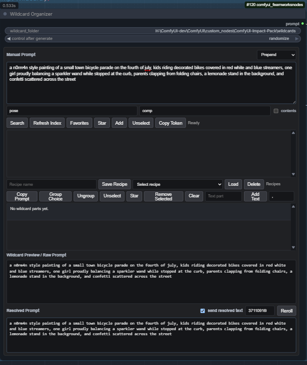
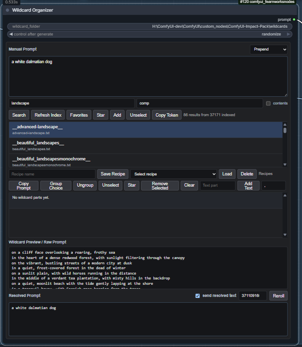
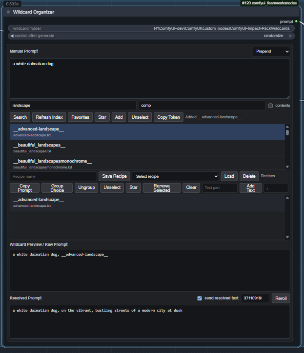
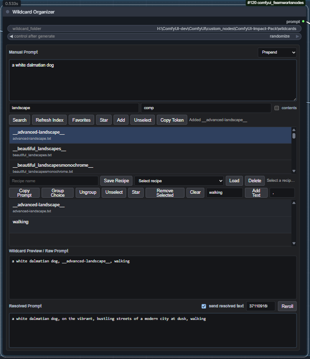
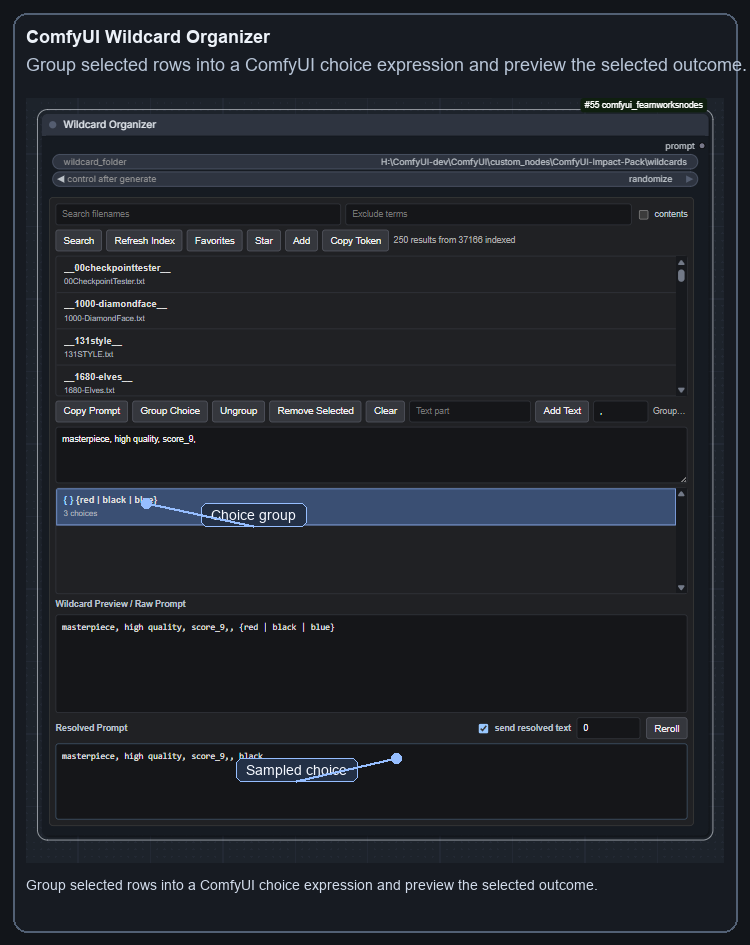
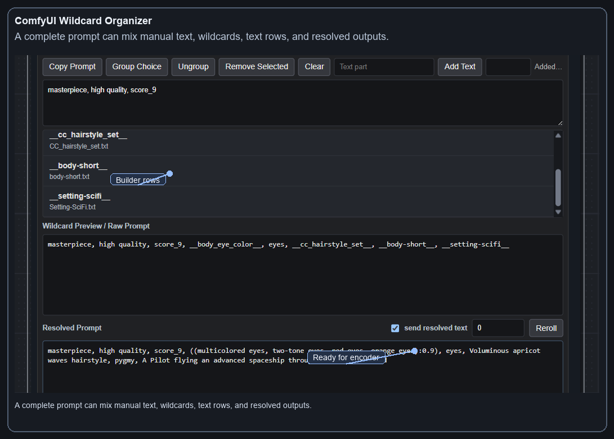

# ComfyUI Wildcard Organizer



A ComfyUI custom node for writing a main prompt, browsing wildcard folders, organizing reusable prompt parts, and seeing the exact resolved prompt text before it goes into your text encoder.

Use it as a prompt-building workspace: type your main prompt, search your wildcard library, add wildcard or text rows, group rows into random choices, and preview the final resolved string before it leaves the node.

## Features

- Search `.txt`, `.yaml`, and `.yml` wildcard files recursively.
- Search by wildcard key, filename, or optionally file contents.
- Write a main manual prompt above the wildcard browser.
- Place the manual prompt before or after the wildcard builder with `Prepend` / `Append`.
- Preview wildcard file contents before adding a token.
- Star frequently used wildcards and custom text tags as browser-local favorites.
- Save and load full prompt recipes.
- Build prompts with draggable wildcard rows and literal text rows.
- Group rows into ComfyUI choice expressions like `{red | blue | black}`.
- Resolve `__wildcard__` tokens and `{choice | groups}` with a deterministic seed.
- Supports ComfyUI seed `fixed`, `increment`, and `randomize` control-after-generate behavior.
- Toggle between sending resolved text or raw wildcard expressions downstream.

## Screenshots

Manual prompt first, with the current Wildcard Organizer layout:


Search wildcard folders and preview matches:



Add a wildcard row to the builder:



Add literal text rows:



Group rows into random choices:



Preview the raw wildcard prompt and the resolved prompt:



## Install

Clone this repository into your ComfyUI custom nodes folder:

```bash
cd ComfyUI/custom_nodes
git clone https://github.com/lokitsar/ComfyUI-WildcardOrganizer.git
```

Or download the repository as a zip and extract it so the folder is:

```text
ComfyUI/custom_nodes/ComfyUI-WildcardOrganizer
```

Then restart ComfyUI.

## Build Your First Prompt

1. Add `utils/wildcards -> Wildcard Organizer` to your workflow.
2. Set `wildcard_folder` to the folder that contains your wildcard files.
3. Type your base prompt in `Manual Prompt`.
4. Choose `Prepend` or `Append` to place the manual prompt before or after the builder rows.
5. Search for a wildcard, such as `hair`, `outfit`, or `background`.
6. Click a search result to preview what is inside it.
7. Press `Add` to put that wildcard into the builder.
8. Use `Text part` and `Add Text` for small reusable tags like `eyes`, `smiling`, or `cinematic lighting`.
9. Select two or more builder rows and press `Group Choice` when you want one random option from a group.
10. Look at `Wildcard Preview / Raw Prompt` to see the wildcard expression.
11. Look at `Resolved Prompt` to see the actual text that will be sent to the next node.
12. Connect the `prompt` output to your text encoder.

The first search builds an in-memory index for the selected wildcard folder. Later searches reuse that index instead of walking the folder again. Press `Refresh Index` after editing wildcard files.

Use `Exclude terms` to filter unwanted filenames, keys, or content. Separate terms with commas, semicolons, or new lines.

Use `Unselect` beside the wildcard buttons to clear the highlighted search result. Use `Unselect` beside the builder buttons to clear selected builder rows.

## Favorites

Use favorites for small pieces you reuse often.

1. Select a wildcard search result and press `Star`.
2. Or select a builder row, such as a custom text tag, and press `Star`.
3. Press `Favorites` to show saved wildcards and text tags.
4. Press `Favorites` again to return to normal search results.

Favorites are saved in your browser local storage. They do not edit your wildcard files.

## Prompt Recipes

Use recipes for whole prompt setups you want to reuse later.

1. Build a prompt with manual text, wildcard rows, text rows, and choice groups.
2. Type a recipe name, such as `Pony portrait base`.
3. Press `Save Recipe`.
4. Pick the recipe from the dropdown later.
5. Press `Load` to restore the manual prompt, manual prompt position, builder rows, separator, seed, and resolved-output setting.

Recipes are also saved in browser local storage.

## Seed Behavior

`Resolved Prompt` uses the node seed to pick wildcard and choice outcomes. Set the ComfyUI control-after-generate option to:

- `fixed` to keep the same wildcard outcome.
- `increment` to walk through deterministic variations.
- `randomize` to pick a new seed each queue.

You can also press `Reroll` to manually pick a new seed.

## Prompt Builder

The builder can compose the final prompt directly:

```text
masterpiece, high quality, score_9, __body_eye_color__, eyes, __cc_hairstyle_set__, __body-short__, __setting-scifi__
```

The raw prompt stays visible, while the resolved prompt shows the sampled output:

```text
masterpiece, high quality, score_9, ((multicolored eyes, two-tone eyes):0.9), eyes, Voluminous apricot waves hairstyle, pygmy, A Pilot flying an advanced spaceship through an asteroid field
```

Use `send resolved text` to choose whether the output sends the resolved prompt or the raw wildcard expression. Edit the seed, use ComfyUI seed controls, or press `Reroll` to pick a different deterministic wildcard outcome.

## Wildcard Naming

The node emits normal ComfyUI wildcard tokens such as:

```text
__hair-color__
__people/hair-color__
```

For `.txt` files, wildcard keys come from the file path relative to the wildcard folder, with the extension removed:

- Backslashes are converted to `/`.
- Spaces are converted to `-`.
- Keys are lowercased.

For `.yaml` and `.yml` files, entries are expanded from YAML keys, including nested keys.

This path behavior is compatible with the common Impact Pack wildcard convention, but the node is intended for ordinary ComfyUI wildcard folders too.

## Output

The node has one output:

- `prompt`: the composed prompt string, either resolved or raw depending on the `send resolved text` checkbox.

## LLM Wildcards & Prompt Variations

Find **LLM Wildcards & Prompt Variations** under **utils/wildcards**. Existing Prompt Variations nodes gain the combined editor. Older Wildcard Prompt nodes still load. Connect **first_prompt** to a string input on your text encoder, or queue the node on its own and copy the output.

**Insert wildcards.** Write your prompt, place the cursor, and click **Insert wildcard…**. Search saved categories or enter a new name. Add instructions and examples if desired. Use **Edit wildcards… → Save wildcard** to create or update a category independently of the prompt. **Save category and insert** inserts a marker such as `{{outdoor setting}}`. Each distinct category gets a separate request containing its name, instructions, examples and recent answers. Repeated references to the same category use the same answer within a prompt. Category definitions and recent answers are saved in `llm_wildcards.sqlite3` under the ComfyUI user directory. Editing a category updates it for other workflows on this installation.

**Mark selections.** Paste a prompt, highlight a phrase, click **Mark selection…**, and choose or create a category. Repeat for other parts. In **Selected parts only**, each request contains just that category's information and the selected phrase. ComfyUI assembles the finished prompt locally. To try **Send whole prompt and rewrite**, switch the mode. This sends the original prompt (restoring the text inside selection markers and filling inserted wildcards) and recent whole-prompt rewrites for this template. This mode asks for a variation of the same image. It preserves the subject, scene and style while varying a few visible details. It asks for affirmative visual descriptions and excludes abstract vibes and negative instructions. The node checks the word count against the source (within 20%, with two words of leeway for short prompts) and retries common negative phrasing. Use **additional_rules** for this prompt, for example “Keep the framing and subject. Vary only the fabric and lighting.” These rules are saved with the workflow and sent only in whole-prompt mode.

Set **count** from 1 to 20. The first output preserves the original formatting in selection mode. **Copy queue lines** and the second output provide one unnumbered line per variation, converting internal line breaks to spaces. Paste the copied list into **Prompt Line Queue** to advance through it across renders. The variation node remembers the last 20 completed prompts for each template and mode. Each category has its own adjustable 1–30 answer history. If a small category runs out of distinct answers, shorten its history. Generation retries duplicates up to four total attempts per answer. A batch of 20 prompts with two categories normally makes 40 chat requests.

### Connections

| Provider | Setup |
| --- | --- |
| PolyStrata | Start your model server. The preset uses `http://127.0.0.1:8080/v1`. Set **local_base_url** to the address your server displays if it differs. |
| KoboldCpp | Load a model in KoboldCpp. The preset uses `http://127.0.0.1:5001/v1`. |
| NanoGPT | Select **NanoGPT**, enter your key in the masked field, click **Save key & connect / load models**, then choose a model. Both wildcard nodes share the key on this ComfyUI installation. The key is saved locally outside the workflow. An existing `NANOGPT_API_KEY` environment variable also works. |

For local providers, click **Connect / load models**, then choose the model from the dropdown. You can also type the model ID manually. Leaving **model** empty selects the first local model advertised by the server when you queue the node.

## License

MIT
